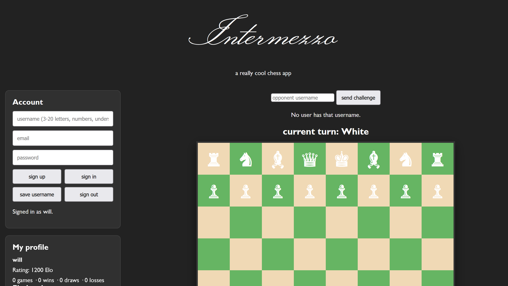

# Intermezzo
a fun chess app



## how it was made
- html
- node.js
- firebase :D
- css
- love

## features
- play chess
- profile
- challenge people
- elo rating
- analysis with stockfish

## stockfish
stockfish is a chess engine! if you dont know what that is, it is basically something that rates how well you did and brutally roasts you (it doesnt actually roast you tho)

## elo
so, if you dont know alr, elo is your chess ranking. by winning, your elo increases. if you lose, your elo decreases. if you draw, both you and your opponents elo decreases (or it stays the same it depends)

## run locally
add your details from firebase (the goog thing) to firebase-client.js and run

```shell
npm install
npm start
```